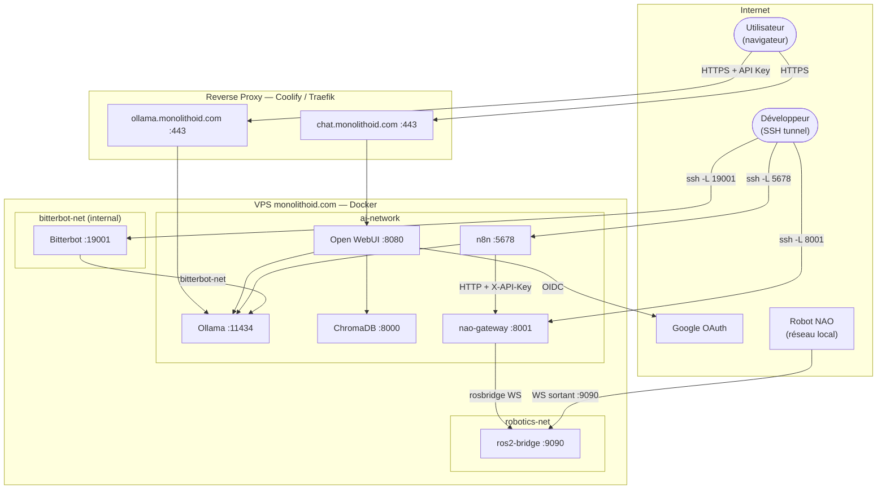

# ia-agent — Stack IA unifiée

Stack IA auto-hébergée sur VPS Ubuntu, déployée via Docker Compose et gérée par Coolify. Elle regroupe un moteur LLM, une interface de chat, un orchestrateur de workflows, une mémoire vectorielle, un agent autonome et une infrastructure robotique (NAO via ROS 2).

## Architecture



## Structure du dépôt

```
ia-agent/
├── core/bitterbot/          → Dockerfile + config template de l'agent Bitterbot
├── robotics/
│   ├── ros2/                → Dockerfile ROS 2 Jazzy + rosbridge_suite
│   └── nao/
│       ├── nao_ws_bridge.py → Script Python 2.7 embarqué sur le robot
│       └── gateway/         → FastAPI : n8n → rosbridge → NAO
├── docs/
│   ├── architecture.md
│   └── decisions/           → ADR (Architecture Decision Records)
├── .github/workflows/
│   ├── build-bitterbot.yml  → Build + push monolithoid/bitterbot
│   └── build-robotics.yml   → Build + push nao-gateway + ros2-bridge
└── docker-compose.yml
```

---

## Déploiement sur Coolify — guide complet

### 1. Prérequis sur le VPS

Se connecter en SSH et créer l'arborescence de données :

```bash
# Stack principale
mkdir -p /opt/ia/ollama /opt/ia/webui /opt/ia/n8n /opt/ia/chroma

# Bitterbot
mkdir -p /opt/ia/bitterbot/config /opt/ia/bitterbot/workspace
mkdir -p /opt/ia/sync/onedrive /opt/ia/sync/gdrive
chown -R 1000:1000 /opt/ia/bitterbot   # uid node dans le container

# Copier le template de config Bitterbot
cp core/bitterbot/bitterbot.json /opt/ia/bitterbot/config/bitterbot.json
# Éditer ce fichier pour y renseigner BITTERBOT_GATEWAY_TOKEN (même valeur que dans Coolify)
```

### 2. Firewall

```bash
ufw allow 22
ufw allow 80
ufw allow 443
ufw allow 9090    # rosbridge WebSocket — NAO se connecte depuis l'extérieur
ufw deny 11434
ufw deny 3000
ufw deny 5678
ufw enable
```

> Les ports 8001 (nao-gateway) et 19001 (Bitterbot) sont liés à `127.0.0.1` dans le compose — pas de règle ufw nécessaire.

### 3. Configurer le projet dans Coolify

1. Coolify → **Projects** → créer le projet **"IA"**
2. **New Resource** → **Docker Compose** → pointer sur ce dépôt Git
3. Laisser le chemin du compose sur `docker-compose.yml` (à la racine)
4. Aller dans **Environment Variables** de la resource et ajouter toutes les variables listées ci-dessous

### 4. Variables d'environnement — à configurer dans Coolify

Toutes les variables sensibles sont injectées par Coolify. Aucun secret n'est commité dans le dépôt.

| Variable | Comment la générer / obtenir |
|---|---|
| `OLLAMA_API_KEYS` | `openssl rand -hex 32` |
| `WEBUI_SECRET_KEY` | `openssl rand -hex 32` |
| `WEBUI_ADMIN_EMAIL` | Ton adresse email |
| `OAUTH_CLIENT_ID` | [console.cloud.google.com](https://console.cloud.google.com) → APIs & Services → Credentials → OAuth 2.0 Client ID |
| `OAUTH_CLIENT_SECRET` | Idem, même credential |
| `N8N_BASIC_AUTH_PASSWORD` | Mot de passe fort de ton choix |
| `BITTERBOT_GATEWAY_TOKEN` | `openssl rand -hex 32` — doit correspondre à `gateway.auth.token` dans `bitterbot.json` |
| `GATEWAY_API_KEY` | `openssl rand -hex 32` — clé `X-API-Key` pour les appels n8n → nao-gateway |

**URI de callback à déclarer dans Google Cloud Console :**
```
https://chat.monolithoid.com/oauth/oidc/callback
```

### 5. Configurer le pipeline CI/CD des images Docker (une seule fois)

Trois images sont buildées automatiquement par GitHub Actions et publiées sur Docker Hub. Le VPS fait uniquement `docker pull` — aucun build sur le serveur.

**a) Créer un Access Token Docker Hub**

Docker Hub → Account Settings → **Security** → **New Access Token**
- Description : `github-actions-ia-agent`
- Permissions : `Read & Write`
- Copier le token (affiché une seule fois)

**b) Ajouter les secrets dans GitHub**

GitHub → repo → **Settings** → **Secrets and variables** → **Actions** :

| Nom | Valeur |
|---|---|
| `DOCKERHUB_USERNAME` | `monolithoid` |
| `DOCKERHUB_TOKEN` | Le token Docker Hub |

**c) Déclencher les premiers builds**

GitHub → **Actions** :
- Workflow **"Build & Push — Bitterbot image"** → **Run workflow**
- Workflow **"Build & Push — Images robotiques"** → **Run workflow**

Chaque build prend 5–15 min. Les images sont ensuite disponibles :
- `monolithoid/bitterbot:latest`
- `monolithoid/nao-gateway:latest`
- `monolithoid/ros2-bridge:latest`

**Rebuilds automatiques :**
- Bitterbot : tous les lundis à 3h00 UTC
- Images robotiques : à chaque push sur `main` qui modifie `robotics/**`

### 6. Démarrer la stack

Dans Coolify → resource **"IA"** → bouton **Deploy** (ou **Start**).

Coolify exécute `docker compose pull && docker compose up -d`. Les données dans `/opt/ia/` sont préservées entre les redémarrages.

---

## Accès aux services

| Service | URL / commande |
|---|---|
| Open WebUI | [chat.monolithoid.com](https://chat.monolithoid.com) — authentification Google |
| API Ollama | `https://ollama.monolithoid.com` + header `Authorization: Bearer $OLLAMA_API_KEYS` |
| n8n | `ssh -L 5678:localhost:5678 user@monolithoid.com` puis [localhost:5678](http://localhost:5678) |
| Bitterbot | `ssh -L 19001:localhost:19001 user@monolithoid.com` puis `ws://localhost:19001` |
| nao-gateway | `ssh -L 8001:localhost:8001 user@monolithoid.com` puis [localhost:8001/docs](http://localhost:8001/docs) |
| rosbridge | Port 9090 — exposé publiquement (NAO se connecte en sortant) |

---

## Mise à jour des services

```bash
# Mettre à jour toutes les images publiées sur Docker Hub
docker compose pull
docker compose up -d

# Mettre à jour un service spécifique
docker compose pull bitterbot-gateway && docker compose up -d bitterbot-gateway
docker compose pull nao-gateway ros2-bridge && docker compose up -d nao-gateway ros2-bridge
```

Ou depuis Coolify : **Redeploy** sur la resource.

---

## Robotique — Stack NAO

### Architecture de la chaîne de commande

```
n8n (workflow)
  └─► POST http://nao-gateway:8001/nao/say
      Header: X-API-Key: $GATEWAY_API_KEY
        └─► nao-gateway (FastAPI, VPS)
              └─► rosbridge WebSocket ws://ros2-bridge:9090
                    └─► ros2-bridge (ROS 2 Jazzy, VPS)
                          └─► /nao/speech (std_msgs/String)
                                └─► nao_ws_bridge.py (NAO, Python 2.7)
                                      └─► ALTextToSpeech.say("Bonjour")
```

### Topics ROS 2 disponibles

| Topic | Type | Action sur le robot |
|---|---|---|
| `/nao/cmd_vel` | `geometry_msgs/Twist` | `ALMotion.moveToward()` |
| `/nao/speech` | `std_msgs/String` | `ALTextToSpeech.say()` |
| `/nao/gesture` | `std_msgs/String` | `ALRobotPosture.goToPosture()` |
| `/nao/leds` | `std_msgs/String` (JSON) | `ALLeds.fadeRGB()` |
| `/nao/stop` | `std_msgs/Empty` | `ALMotion.stopMove()` |
| `/nao/status` | `std_msgs/String` (JSON) | Batterie + température → VPS |

### Déployer le bridge sur le robot NAO

```bash
# Depuis la racine du dépôt
scp robotics/nao/nao_ws_bridge.py nao@NAO_IP:/home/nao/

# SSH sur le robot
ssh nao@NAO_IP

# Installer websocket-client (Python 2.7)
pip install websocket-client==0.59.0

# Lancer le bridge (remplacer VPS_IP par l'IP publique du VPS)
python /home/nao/nao_ws_bridge.py --vps ws://VPS_IP:9090
```

> Si `pip` n'est pas disponible sur le NAO :
> ```bash
> curl https://bootstrap.pypa.io/pip/2.7/get-pip.py | python
> ```

**Lancement automatique au démarrage du NAO** — créer `/home/nao/autostart.sh` :
```bash
#!/bin/bash
sleep 10   # attendre que le réseau soit établi
python /home/nao/nao_ws_bridge.py --vps ws://VPS_IP:9090 &
```
Et l'ajouter dans Choregraphe → Edit → Preferences → Autorun.

### Appels depuis n8n

Utiliser le nœud **HTTP Request** avec :
- **Method** : POST
- **URL** : `http://nao-gateway:8001/nao/<action>`
- **Header** : `X-API-Key: {{ $env.GATEWAY_API_KEY }}`
- **Body** : JSON selon l'action

Exemples :

```json
// POST /nao/say
{ "text": "Bonjour, je suis prêt." }

// POST /nao/move   (valeurs entre -1.0 et 1.0)
{ "linear_x": 0.3, "angular_z": 0.1 }

// POST /nao/gesture
{ "posture": "Stand" }

// POST /nao/leds
{ "name": "FaceLeds", "r": 0.0, "g": 1.0, "b": 0.0 }

// POST /nao/stop
{}
```

**Documentation interactive de l'API** (via tunnel SSH) :
```bash
ssh -L 8001:localhost:8001 user@monolithoid.com
# ouvrir http://localhost:8001/docs
```

### Vérification

```bash
# 1. Le gateway répond
curl http://localhost:8001/health

# 2. Tester say (NAO doit être connecté au rosbridge)
curl -X POST http://localhost:8001/nao/say \
  -H "X-API-Key: $GATEWAY_API_KEY" \
  -H "Content-Type: application/json" \
  -d '{"text": "Test de connexion"}'

# 3. Voir les logs du bridge (si NAO est connecté)
docker logs ros2-bridge
docker logs nao-gateway
```

---

## Services — référence complète

### Ollama — moteur LLM

**Image :** `ollama/ollama:latest`

| Variable | Description |
|---|---|
| `OLLAMA_API_KEYS` | Clé d'API (injectée par Coolify) |
| `OLLAMA_KEEP_ALIVE` | Maintien du modèle en mémoire (`24h`) |
| `OLLAMA_NUM_PARALLEL` | Requêtes simultanées (`2`) |
| `OLLAMA_NUM_THREAD` | Threads CPU alloués (`8`) |

**Volume :** `/opt/ia/ollama` → modèles IA (10–20 Go)

**Télécharger un modèle :**
```bash
docker exec -it ollama ollama pull qwen3:8b
```

---

### Open WebUI — interface de chat

**Image :** `ghcr.io/open-webui/open-webui:main`

Accès restreint aux comptes Google autorisés via SSO (OIDC). Les inscriptions libres sont désactivées.

| Variable | Description |
|---|---|
| `WEBUI_SECRET_KEY` | Secret JWT pour les sessions |
| `WEBUI_ADMIN_EMAIL` | Email du compte administrateur |
| `OAUTH_CLIENT_ID` | Client ID Google |
| `OAUTH_CLIENT_SECRET` | Secret Google |
| `OLLAMA_API_KEY` | Même valeur que `OLLAMA_API_KEYS` |

**Volume :** `/opt/ia/webui` → agents, utilisateurs, historique

---

### n8n — workflows et automatisations

**Image :** `n8nio/n8n:latest`

Non exposé publiquement. Accès via tunnel SSH uniquement.

```bash
ssh -L 5678:localhost:5678 user@monolithoid.com
```

| Variable | Description |
|---|---|
| `N8N_BASIC_AUTH_PASSWORD` | Mot de passe de l'interface |

**Volume :** `/opt/ia/n8n` → workflows

---

### ChromaDB — mémoire vectorielle

**Image :** `chromadb/chroma:latest`

Interne uniquement — jamais exposé. Utilisé par Open WebUI pour le RAG.

**Volume :** `/opt/ia/chroma` → index vectoriel

---

### Bitterbot — agent IA autonome

**Image :** `monolithoid/bitterbot:latest` (buildée par GitHub Actions, publiée sur Docker Hub)

Agent avec mémoire long-terme (SQLite), Dream Engine de consolidation, inférence 100 % locale via Ollama. Non exposé publiquement.

**Isolation réseau :** `bitterbot-net` avec `internal: true` — aucun accès internet possible au niveau Docker. Seul Ollama est joignable.

| Variable | Description |
|---|---|
| `BITTERBOT_GATEWAY_TOKEN` | Secret d'auth WebSocket — doit correspondre à `gateway.auth.token` dans `bitterbot.json` |

**Volumes :**

| Chemin hôte | Chemin container | Mode |
|---|---|---|
| `/opt/ia/bitterbot/config` | `/home/node/.bitterbot` | rw |
| `/opt/ia/bitterbot/workspace` | `/home/node/.bitterbot/workspace` | rw |
| `/opt/ia/sync/onedrive` | `/home/node/.bitterbot/workspace/onedrive` | ro |
| `/opt/ia/sync/gdrive` | `/home/node/.bitterbot/workspace/gdrive` | ro |

**Mettre à jour le modèle :** éditer `model:` dans `/opt/ia/bitterbot/config/bitterbot.json`.

---

### ros2-bridge — hub ROS 2

**Image :** `monolithoid/ros2-bridge:latest` (buildée par GitHub Actions)

ROS 2 Jazzy Jalisco + `rosbridge_suite`. Expose le WebSocket JSON rosbridge sur le port 9090. Le NAO se connecte EN SORTIE à ce port — aucune connexion entrante vers le robot n'est nécessaire.

---

### nao-gateway — API REST pour le NAO

**Image :** `monolithoid/nao-gateway:latest` (buildée par GitHub Actions)

FastAPI qui expose des endpoints HTTP simples pour n8n et traduit les commandes en messages ROS 2 via rosbridge.

| Variable | Description |
|---|---|
| `ROSBRIDGE_URL` | Adresse interne de ros2-bridge (`ws://ros2-bridge:9090`) |
| `GATEWAY_API_KEY` | Clé d'authentification pour le header `X-API-Key` |

---

## Synchronisation cloud — rclone

Les dossiers `/opt/ia/sync/onedrive` et `/opt/ia/sync/gdrive` sont alimentés par `rclone` sur le VPS et montés en lecture seule dans le workspace de Bitterbot.

### Installation

```bash
curl https://rclone.org/install.sh | sudo bash
```

### Configuration (depuis ton poste local)

L'authentification OAuth nécessite un navigateur — faire la config en local puis copier sur le VPS.

**Google Drive :**
```bash
rclone config
# → n, name: gdrive, Storage: drive, laisser client_id vide, scope: 1
# → authentification navigateur, pas de Shared Drive
```

**OneDrive :**
```bash
rclone config
# → n, name: onedrive, Storage: onedrive, laisser client_id vide
# → authentification navigateur, type: onedrive, drive_id: 0
```

**Copier la config sur le VPS :**
```bash
scp ~/.config/rclone/rclone.conf user@monolithoid.com:/root/.config/rclone/rclone.conf
```

### Services systemd (synchronisation toutes les 15 min)

Créer `/etc/systemd/system/rclone-onedrive.service` :
```ini
[Unit]
Description=rclone sync — OneDrive → /opt/ia/sync/onedrive
After=network-online.target
Wants=network-online.target

[Service]
Type=oneshot
ExecStart=/usr/bin/rclone sync onedrive: /opt/ia/sync/onedrive \
    --log-file=/var/log/rclone-onedrive.log --log-level=INFO \
    --transfers=4 --checkers=8 --retries=3
```

Créer `/etc/systemd/system/rclone-onedrive.timer` :
```ini
[Unit]
Description=Sync OneDrive toutes les 15 minutes

[Timer]
OnBootSec=2min
OnUnitActiveSec=15min
Unit=rclone-onedrive.service

[Install]
WantedBy=timers.target
```

Répéter pour `rclone-gdrive` (remplacer `onedrive:` par `gdrive:` et les chemins).

```bash
systemctl daemon-reload
systemctl enable --now rclone-onedrive.timer rclone-gdrive.timer
systemctl list-timers --all | grep rclone
```

---

## Diagnostic

```bash
# État de tous les containers
docker compose ps

# Logs d'un service
docker logs ollama -f
docker logs nao-gateway -f
docker logs ros2-bridge -f

# Vérifier l'isolation réseau de Bitterbot
docker exec bitterbot-gateway curl -s --max-time 3 https://example.com
# Attendu : timeout ou "Could not resolve host"

# Vérifier que Bitterbot atteint Ollama
docker exec bitterbot-gateway curl -s http://ollama:11434/api/tags | head -c 100
```
