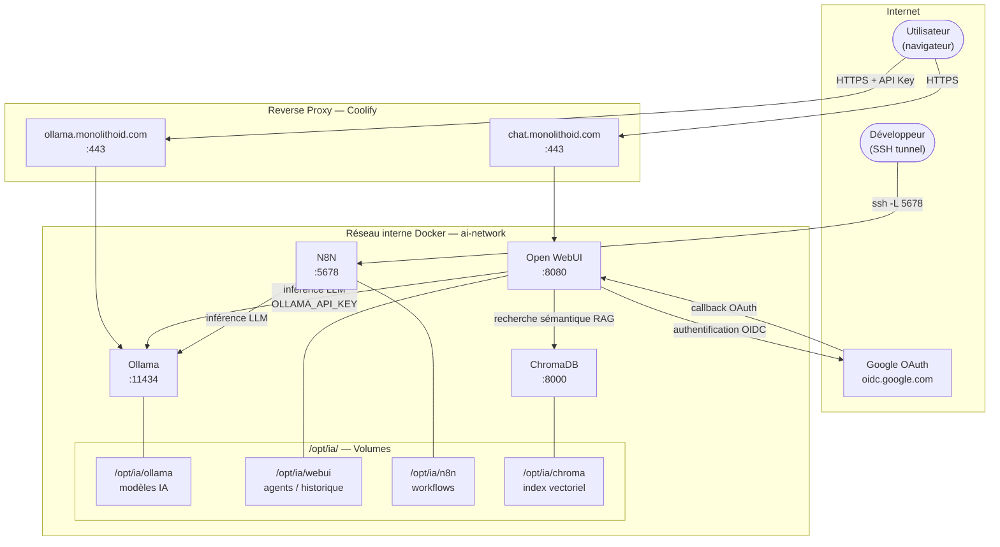

# ia-agent

Stack IA auto-hébergée sur VPS, déployée via Docker Compose. Elle regroupe un moteur LLM, une interface de chat, un moteur de workflows et une base vectorielle.

## Architecture



## Services

### Ollama — moteur LLM

**Image :** `ollama/ollama:latest`

Moteur d'inférence local qui fait tourner les modèles de langage (LLM). Exposé publiquement via le sous-domaine `ollama.monolithoid.com` et protégé par une clé d'API.

| Variable | Description |
|---|---|
| `OLLAMA_KEEP_ALIVE` | Durée de maintien du modèle en mémoire (24h) |
| `OLLAMA_NUM_PARALLEL` | Nombre de requêtes traitées simultanément |
| `OLLAMA_NUM_THREAD` | Nombre de threads CPU alloués |
| `OLLAMA_API_KEYS` | Clé secrète pour protéger l'API |

**Volume :** `/opt/ia/ollama` → stockage des modèles IA (10–20 Go).

---

### Open WebUI — interface de chat et d'agents

**Image :** `ghcr.io/open-webui/open-webui:main`

Interface web qui permet d'interagir avec Ollama via une UI type ChatGPT. Exposée via `chat.monolithoid.com`. L'accès est restreint aux comptes Google autorisés (SSO via OAuth 2.0 / OIDC) — les inscriptions libres sont désactivées.

| Variable | Description |
|---|---|
| `OLLAMA_BASE_URL` | Adresse interne d'Ollama |
| `OLLAMA_API_KEY` | Clé d'API partagée avec Ollama |
| `WEBUI_SECRET_KEY` | Secret JWT pour les sessions utilisateurs |
| `CHROMA_HTTP_HOST/PORT` | Connexion interne à ChromaDB |
| `DEFAULT_MODELS` | Modèle chargé par défaut (`qwen2.5:7b`) |
| `ENABLE_SIGNUP` | `false` — inscriptions libres désactivées |
| `ENABLE_OAUTH_SIGNUP` | `true` — inscription via Google SSO autorisée |
| `WEBUI_ADMIN_EMAIL` | Email du compte administrateur |
| `OAUTH_PROVIDER_NAME` | Nom du fournisseur OAuth affiché (Google) |
| `OPENID_PROVIDER_URL` | URL de découverte OIDC de Google |
| `OAUTH_CLIENT_ID` | Client ID Google OAuth |
| `OAUTH_CLIENT_SECRET` | Secret Google OAuth |
| `OAUTH_REDIRECT_URI` | URI de callback après authentification |

> Pour restreindre l'accès à un domaine Google spécifique, décommenter et renseigner :
> `GOOGLE_ALLOWED_DOMAINS=mondomaine.com`

**Volume :** `/opt/ia/webui` → agents, utilisateurs, historique de chat.

---

### N8N — workflows et automatisations

**Image :** `n8nio/n8n:latest`

Moteur de workflows no-code/low-code. **Non exposé publiquement** — accessible uniquement via tunnel SSH pour des raisons de sécurité.

**Accès depuis ton poste :**
```bash
ssh -L 5678:localhost:5678 user@monolithoid.com
# puis ouvrir http://localhost:5678
```

| Variable | Description |
|---|---|
| `N8N_HOST` | Hôte d'écoute de N8N |
| `N8N_PORT` | Port interne (5678) |
| `N8N_BASIC_AUTH_ACTIVE` | Active l'authentification basique |
| `N8N_BASIC_AUTH_USER` | Identifiant admin |
| `N8N_BASIC_AUTH_PASSWORD` | Mot de passe admin |
| `OLLAMA_HOST` | Adresse interne d'Ollama pour les workflows IA |

> Pour exposer N8N publiquement (webhooks entrants) : décommenter les `ports:`, ajouter un sous-domaine dans Coolify, et retirer `ufw deny 5678`.

**Volume :** `/opt/ia/n8n` → workflows sauvegardés.

---

### ChromaDB — mémoire vectorielle

**Image :** `chromadb/chroma:latest`

Base de données vectorielle utilisée par Open WebUI pour la mémoire long-terme et la recherche sémantique (RAG). **Jamais exposé publiquement.**

| Variable | Description |
|---|---|
| `IS_PERSISTENT` | Activer la persistence des données |
| `ANONYMIZED_TELEMETRY` | Désactiver la télémétrie (`FALSE`) |

**Volume :** `/opt/ia/chroma` → index vectoriel.

---

## Réseau interne

Tous les services communiquent via le réseau Docker `ai-network` (bridge). Les containers se joignent par leur nom de service :

```
http://ollama:11434
http://chromadb:8000
http://n8n:5678
```

## Déploiement

### 1. Prérequis — créer les dossiers sur le VPS

```bash
mkdir -p /opt/ia/ollama /opt/ia/webui /opt/ia/n8n /opt/ia/chroma
```

### 2. Configurer les secrets

Remplacer toutes les valeurs `CHANGE_THIS_*` dans `docker-compose.yml` :

| Valeur | Comment la générer |
|---|---|
| `CHANGE_THIS_OLLAMA_KEY` | `openssl rand -hex 32` |
| `CHANGE_THIS_WEBUI_SECRET` | `openssl rand -hex 32` |
| `CHANGE_THIS_N8N_PASSWORD` | Mot de passe de ton choix |
| `CHANGE_THIS_GOOGLE_CLIENT_ID` | Depuis [console.cloud.google.com](https://console.cloud.google.com) → APIs & Services → Credentials → OAuth 2.0 Client ID |
| `CHANGE_THIS_GOOGLE_CLIENT_SECRET` | Idem, même credential |
| `CHANGE_THIS_EMAIL` | Email du compte administrateur Open WebUI |

**URI de callback OAuth à déclarer dans la console Google :**
```
https://chat.monolithoid.com/oauth/oidc/callback
```

### 3. Configurer le firewall

```bash
ufw allow 22
ufw allow 80
ufw allow 443
ufw deny 11434
ufw deny 3000
ufw deny 5678
ufw enable
```

> Les ports 3000, 11434 et 5678 ne doivent pas être accessibles directement — le trafic passe par le reverse proxy (Coolify).

### 4. Lancer la stack

```bash
docker compose up -d
```

## Gestion via Coolify

La stack est gérée comme un projet "IA" séparé dans Coolify. Start/Stop depuis l'onglet **Services** du projet. Les données dans `/opt/ia/` sont préservées entre les redémarrages.

## Stockage

| Dossier | Contenu | Taille estimée |
|---|---|---|
| `/opt/ia/ollama` | Modèles IA téléchargés | 10–20 Go |
| `/opt/ia/webui` | Agents, utilisateurs, historique | Variable |
| `/opt/ia/n8n` | Workflows N8N | Faible |
| `/opt/ia/chroma` | Index vectoriel ChromaDB | Variable |
