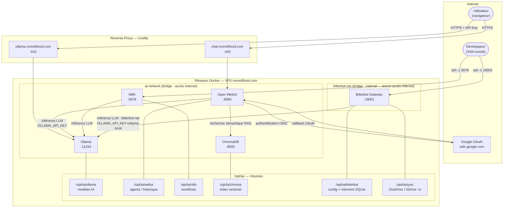

# ia-agent

Stack IA auto-hébergée sur VPS, déployée via Docker Compose. Elle regroupe un moteur LLM, une interface de chat, un moteur de workflows et une base vectorielle.

## Architecture



## Services

### Ollama — moteur LLM

**Image :** `ollama/ollama:latest`

Moteur d'inférence local qui fait tourner les modèles de langage (LLM). Exposé publiquement via le sous-domaine `ollama.monolithoid.com` et protégé par une clé d'API.

| Variable | Description |
|---|---|
| `OLLAMA_KEEP_ALIVE` | Durée de maintien du modèle en mémoire (24h) |
| `OLLAMA_NUM_PARALLEL` | Nombre de requêtes traitées simultanément |
| `OLLAMA_NUM_THREAD` | Nombre de threads CPU alloués |
| `OLLAMA_API_KEYS` | Clé secrète pour protéger l'API |

**Volume :** `/opt/ia/ollama` → stockage des modèles IA (10–20 Go).

---

### Open WebUI — interface de chat et d'agents

**Image :** `ghcr.io/open-webui/open-webui:main`

Interface web qui permet d'interagir avec Ollama via une UI type ChatGPT. Exposée via `chat.monolithoid.com`. L'accès est restreint aux comptes Google autorisés (SSO via OAuth 2.0 / OIDC) — les inscriptions libres sont désactivées.

| Variable | Description |
|---|---|
| `OLLAMA_BASE_URL` | Adresse interne d'Ollama |
| `OLLAMA_API_KEY` | Clé d'API partagée avec Ollama |
| `WEBUI_SECRET_KEY` | Secret JWT pour les sessions utilisateurs |
| `CHROMA_HTTP_HOST/PORT` | Connexion interne à ChromaDB |
| `DEFAULT_MODELS` | Modèle chargé par défaut (`qwen2.5:7b`) |
| `ENABLE_SIGNUP` | `false` — inscriptions libres désactivées |
| `ENABLE_OAUTH_SIGNUP` | `true` — inscription via Google SSO autorisée |
| `WEBUI_ADMIN_EMAIL` | Email du compte administrateur |
| `OAUTH_PROVIDER_NAME` | Nom du fournisseur OAuth affiché (Google) |
| `OPENID_PROVIDER_URL` | URL de découverte OIDC de Google |
| `OAUTH_CLIENT_ID` | Client ID Google OAuth |
| `OAUTH_CLIENT_SECRET` | Secret Google OAuth |
| `OAUTH_REDIRECT_URI` | URI de callback après authentification |

> Pour restreindre l'accès à un domaine Google spécifique, décommenter et renseigner :
> `GOOGLE_ALLOWED_DOMAINS=mondomaine.com`

**Volume :** `/opt/ia/webui` → agents, utilisateurs, historique de chat.

---

### N8N — workflows et automatisations

**Image :** `n8nio/n8n:latest`

Moteur de workflows no-code/low-code. **Non exposé publiquement** — accessible uniquement via tunnel SSH pour des raisons de sécurité.

**Accès depuis ton poste :**
```bash
ssh -L 5678:localhost:5678 user@monolithoid.com
# puis ouvrir http://localhost:5678
```

| Variable | Description |
|---|---|
| `N8N_HOST` | Hôte d'écoute de N8N |
| `N8N_PORT` | Port interne (5678) |
| `N8N_BASIC_AUTH_ACTIVE` | Active l'authentification basique |
| `N8N_BASIC_AUTH_USER` | Identifiant admin |
| `N8N_BASIC_AUTH_PASSWORD` | Mot de passe admin |
| `OLLAMA_HOST` | Adresse interne d'Ollama pour les workflows IA |

> Pour exposer N8N publiquement (webhooks entrants) : décommenter les `ports:`, ajouter un sous-domaine dans Coolify, et retirer `ufw deny 5678`.

**Volume :** `/opt/ia/n8n` → workflows sauvegardés.

---

### ChromaDB — mémoire vectorielle

**Image :** `chromadb/chroma:latest`

Base de données vectorielle utilisée par Open WebUI pour la mémoire long-terme et la recherche sémantique (RAG). **Jamais exposé publiquement.**

| Variable | Description |
|---|---|
| `IS_PERSISTENT` | Activer la persistence des données |
| `ANONYMIZED_TELEMETRY` | Désactiver la télémétrie (`FALSE`) |

**Volume :** `/opt/ia/chroma` → index vectoriel.

---

### Bitterbot — agent IA local avec mémoire persistante

**Image :** buildée depuis les sources ([Bitterbot-AI/bitterbot-desktop](https://github.com/Bitterbot-AI/bitterbot-desktop)) avec `docker compose build bitterbot-gateway`.

Agent autonome avec mémoire long-terme, Dream Engine de consolidation, et inférence 100 % locale via Ollama. **Non exposé publiquement** — accessible uniquement via tunnel SSH.

**Accès depuis ton poste :**
```bash
ssh -L 19001:localhost:19001 user@monolithoid.com
# puis : http://localhost:19001 (API OpenAI-compatible)
#         ws://localhost:19001  (WebSocket)
```

**Isolation réseau complète** — Bitterbot est sur `bitterbot-net` (`internal: true`) : Docker bloque toute sortie vers internet au niveau kernel, indépendamment de la configuration applicative. Seul Ollama est joignable (connecté aux deux réseaux).

**Composants désactivés :**

| Composant | Mécanisme de désactivation |
|---|---|
| WhatsApp / Telegram / Discord / Signal / Slack | `BITTERBOT_SKIP_CHANNELS=1` + `channels.*.enabled: false` |
| Wallet USDC / x402 micropayments | `wallet.enabled: false` + `BITTERBOT_ONRAMP_URL` vers loopback + réseau interne |
| Marketplace P2P / libp2p Gossipsub | `discovery.enabled: false` + réseau interne |
| LLM cloud (Anthropic, OpenAI, Gemini…) | Aucune clé API configurée, `OLLAMA_API_KEY=ollama-local` |

**Dream Engine** — pipeline de consolidation mémoire actif par défaut, cycle de 2h. Utilise 7 modes (Replay, Mutation, Extrapolation, Compression, Simulation, Exploration, Research) activés selon l'état du graphe mémoriel. DB SQLite persistée dans `/opt/ia/bitterbot/config/memory/memory.db`.

| Variable | Description |
|---|---|
| `BITTERBOT_GATEWAY_TOKEN` | Secret d'auth WebSocket (générer : `openssl rand -hex 32`) |
| `OLLAMA_API_KEY` | Clé fictive pour Ollama local (`ollama-local`) |
| `BITTERBOT_SKIP_CHANNELS` | Désactive l'init des canaux messaging au démarrage |
| `BITTERBOT_ONRAMP_URL` | Redirige l'onramp Stripe vers un endpoint inexistant |

**Volumes :**

| Volume hôte | Chemin container | Mode |
|---|---|---|
| `/opt/ia/bitterbot/config` | `/home/node/.bitterbot` | rw — config, mémoire, état agent |
| `/opt/ia/bitterbot/workspace` | `/home/node/.bitterbot/workspace` | rw — espace de travail |
| `/opt/ia/sync/onedrive` | `/home/node/.bitterbot/workspace/onedrive` | **ro** — OneDrive synchronisé |
| `/opt/ia/sync/gdrive` | `/home/node/.bitterbot/workspace/gdrive` | **ro** — Google Drive synchronisé |

> **Modèles disponibles :** `qwen2.5:7b` (défaut) ou `dolphin-llama3:8b`. Changer `model:` dans `bitterbot/bitterbot.json`.

---

## Réseaux internes

La stack utilise deux réseaux Docker distincts :

### `ai-network` — réseau principal (bridge, accès internet)

Regroupe Ollama, Open WebUI, N8N et ChromaDB. Les containers peuvent joindre internet (nécessaire pour les webhooks N8N, les mises à jour, etc.).

```
http://ollama:11434
http://chromadb:8000
http://n8n:5678
```

### `bitterbot-net` — réseau isolé (bridge, `internal: true`)

Regroupe Bitterbot Gateway et Ollama (multi-homed). L'option `internal: true` supprime la route par défaut du namespace réseau Docker : **aucun paquet ne peut sortir vers internet**, même si l'application tente un appel externe.

```
http://ollama:11434     → Ollama (seul service joignable depuis Bitterbot)
ws://bitterbot-gateway:19001
```

> Ollama est le seul service connecté aux deux réseaux, ce qui lui permet de répondre aux requêtes de Bitterbot sans exposer internet à ce dernier.

## Déploiement

### 1. Prérequis — créer les dossiers sur le VPS

```bash
# Stack principale
mkdir -p /opt/ia/ollama /opt/ia/webui /opt/ia/n8n /opt/ia/chroma

# Bitterbot — config + workspace + sync drives
mkdir -p /opt/ia/bitterbot/config /opt/ia/bitterbot/workspace
mkdir -p /opt/ia/sync/onedrive /opt/ia/sync/gdrive

# Permissions — uid 1000 = user "node" dans le container Bitterbot
chown -R 1000:1000 /opt/ia/bitterbot
```

> **Chemins OneDrive / GDrive** — adapter `/opt/ia/sync/onedrive` et `/opt/ia/sync/gdrive` aux chemins réels de ta synchronisation (rclone mount, syncthing, etc.). Ces dossiers sont montés en lecture seule dans le workspace de l'agent.

### 2. Configurer les secrets

Remplacer toutes les valeurs `CHANGE_THIS_*` dans `docker-compose.yml` :

| Valeur | Comment la générer |
|---|---|
| `CHANGE_THIS_OLLAMA_KEY` | `openssl rand -hex 32` |
| `CHANGE_THIS_WEBUI_SECRET` | `openssl rand -hex 32` |
| `CHANGE_THIS_N8N_PASSWORD` | Mot de passe de ton choix |
| `CHANGE_THIS_BITTERBOT_TOKEN` | `openssl rand -hex 32` |
| `CHANGE_THIS_GOOGLE_CLIENT_ID` | Depuis [console.cloud.google.com](https://console.cloud.google.com) → APIs & Services → Credentials → OAuth 2.0 Client ID |
| `CHANGE_THIS_GOOGLE_CLIENT_SECRET` | Idem, même credential |
| `CHANGE_THIS_EMAIL` | Email du compte administrateur Open WebUI |

**URI de callback OAuth à déclarer dans la console Google :**
```
https://chat.monolithoid.com/oauth/oidc/callback
```

### 3. Configurer Bitterbot

```bash
# Copier le template de configuration sur le VPS
cp bitterbot/bitterbot.json /opt/ia/bitterbot/config/bitterbot.json

# Ouvrir le fichier et remplacer CHANGE_THIS_BITTERBOT_TOKEN
# par la même valeur que dans docker-compose.yml
nano /opt/ia/bitterbot/config/bitterbot.json
```

> Le fichier `bitterbot/bitterbot.json` dans ce dépôt est le template versionné. Le fichier réel sur le VPS (avec les secrets) ne doit **pas** être commité dans git.

### 4. Configurer le firewall

```bash
ufw allow 22
ufw allow 80
ufw allow 443
ufw deny 11434
ufw deny 3000
ufw deny 5678
# Port 19001 (Bitterbot) : lié à 127.0.0.1 dans docker-compose, pas d'ufw nécessaire
ufw enable
```

> Les ports 3000, 11434 et 5678 ne doivent pas être accessibles directement — le trafic passe par le reverse proxy (Coolify). Le port 19001 est déjà lié à `127.0.0.1` dans le compose.

### 5. Builder l'image Bitterbot

L'image Bitterbot est construite depuis les sources (~5 min, requiert Git et internet sur le VPS) :

```bash
docker compose build bitterbot-gateway
```

> Cette étape est à faire **une seule fois** (ou après une mise à jour du dépôt source). Le build clone automatiquement le dépôt officiel et compile le projet Node.js.

### 6. Lancer la stack

```bash
docker compose up -d
```

### 7. Vérifier l'isolation réseau de Bitterbot

```bash
# Bitterbot ne doit pas pouvoir joindre internet
docker exec bitterbot-gateway curl -s --max-time 3 https://example.com
# Attendu : "curl: (6) Could not resolve host" ou timeout

# Bitterbot doit pouvoir joindre Ollama
docker exec bitterbot-gateway curl -s http://ollama:11434/api/tags | head -c 100
# Attendu : JSON avec la liste des modèles
```

## Configuration Coolify

Coolify gère le cycle de vie de la stack via son interface web. Voici les points spécifiques à configurer pour Bitterbot.

### Déclarer la stack dans Coolify

1. Dans Coolify → **Projects** → créer ou ouvrir le projet "IA"
2. **New Resource** → **Docker Compose** → coller le contenu de `docker-compose.yml`
3. Dans les **Environment Variables** de la resource, déclarer tous les `CHANGE_THIS_*`
   _(Coolify injecte ces variables dans l'environnement du compose sans les persister dans le fichier)_

### Variables d'environnement à déclarer dans Coolify

| Variable | Valeur |
|---|---|
| `CHANGE_THIS_OLLAMA_KEY` | `openssl rand -hex 32` |
| `CHANGE_THIS_WEBUI_SECRET` | `openssl rand -hex 32` |
| `CHANGE_THIS_N8N_PASSWORD` | Mot de passe fort |
| `CHANGE_THIS_BITTERBOT_TOKEN` | `openssl rand -hex 32` (même valeur que dans `bitterbot.json`) |
| `CHANGE_THIS_GOOGLE_CLIENT_ID` | Client ID Google OAuth |
| `CHANGE_THIS_GOOGLE_CLIENT_SECRET` | Secret Google OAuth |
| `CHANGE_THIS_EMAIL` | Email admin Open WebUI |

### Build de l'image Bitterbot via Coolify

Coolify ne gère pas nativement le `build:` d'un service avec une URL GitHub comme contexte. **Avant** de démarrer la stack depuis Coolify :

```bash
# Se connecter au VPS via SSH et builder l'image manuellement
ssh user@monolithoid.com
cd /chemin/vers/ia-agent
docker compose build bitterbot-gateway
```

Ensuite, Coolify peut démarrer la stack normalement (il trouvera l'image `bitterbot:local` déjà présente localement).

> Pour une mise à jour de Bitterbot, relancer `docker compose build bitterbot-gateway` puis **Restart** depuis Coolify.

### Démarrer / arrêter la stack

Depuis l'onglet **Services** du projet Coolify → bouton **Start** / **Stop**. Les données dans `/opt/ia/` sont préservées entre les redémarrages.

## Stockage

| Dossier | Contenu | Taille estimée |
|---|---|---|
| `/opt/ia/ollama` | Modèles IA téléchargés | 10–20 Go |
| `/opt/ia/webui` | Agents, utilisateurs, historique | Variable |
| `/opt/ia/n8n` | Workflows N8N | Faible |
| `/opt/ia/chroma` | Index vectoriel ChromaDB | Variable |
| `/opt/ia/bitterbot/config` | Config, mémoire SQLite (Dream Engine), état agent | Variable |
| `/opt/ia/bitterbot/workspace` | Espace de travail de l'agent (fichiers générés) | Variable |
| `/opt/ia/sync/onedrive` | OneDrive synchronisé — lecture seule pour Bitterbot | Dépend de la sync |
| `/opt/ia/sync/gdrive` | Google Drive synchronisé — lecture seule pour Bitterbot | Dépend de la sync |
