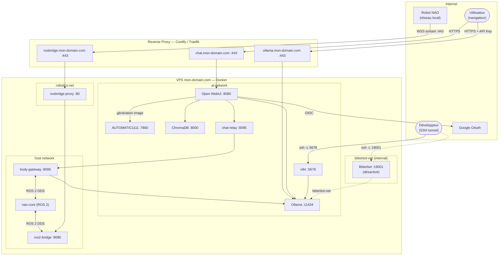

# ia-agent — Stack IA unifiée

Stack IA auto-hébergée sur VPS Ubuntu, déployée via Docker Compose et gérée par Coolify. Elle regroupe un moteur LLM, une interface de chat, un orchestrateur de workflows, une mémoire vectorielle, un agent autonome et une infrastructure robotique (NAO via ROS 2).

## Documentation

| Section | Description |
|---|---|
| [Architecture](docs/architecture.md) | Vision, infrastructure, réseaux Docker |
| [Récapitulatif des containers](docs/containers-overview.md) | Tableau synthétique de tous les containers, entrées/sorties, formats |
| [Stack IA](docs/ia-stack.md) | Ollama, Open WebUI, n8n, ChromaDB, AUTOMATIC1111, Bitterbot |
| [Bridge IA / ROS 2 / NAO](docs/bridge-ia-ros2-nao.md) | nao-core, body-gateway, ros2-bridge, topics ROS 2 |
| [Robot NAO](docs/nao.md) | Bridge embarqué sur le robot, déploiement, autostart |
| [Test de la chaîne](docs/test-chain.md) | Diagnostic maillon par maillon WebUI → NAO |
| [Coolify & VPS](docs/coolify-vps.md) | Prérequis VPS, déploiement Coolify, CI/CD, cloud sync |

### Décisions d'architecture (ADR)

| ADR | Décision |
|---|---|
| [ADR 001](docs/decisions/001-ros2-over-ros1.md) | ROS 2 plutôt que ROS 1 |
| [ADR 002](docs/decisions/002-nao-websocket-bridge.md) | Bridge WebSocket embarqué sur NAO (sans VPN ni Raspberry Pi) |
| [ADR 003](docs/decisions/003-ollama-direct-sans-bitterbot.md) | Ollama direct sans Bitterbot pour body-gateway |

---

## Architecture



---

## Structure du dépôt

```
ia-agent/
├── core/
│   ├── automatic1111/       → Dockerfile + entrypoint (Stable Diffusion CPU, DreamShaper 8)
│   └── bitterbot/           → Dockerfile + config template de l'agent Bitterbot
├── robotics/
│   ├── motion_engine/       → Package ROS 2 : synthèse biomécanique (émotion → mouvement)
│   ├── nao_core/            → Dockerfile + entrypoint du container nao-core
│   ├── shared/              → Classes partagées (RobotBridgeBase)
│   └── nao_brain/
│       ├── naoqi_bridge/    → HTTP bridge Python 2.7 (NAOqi SDK)
│       ├── naoqi_driver/    → Nœud ROS 2 : topics → HTTP vers naoqi_bridge
│       ├── cognitive_renderer/ → Nœud ROS 2 : état cognitif → LEDs / tête
│       ├── ros2_bridge/     → Dockerfile rosbridge_server WebSocket
│       ├── body_gateway/    → Cerveau ROS 2 : LLM ↔ corps robotiques
│       └── webui/           → Pipe Open WebUI (nao_pipe.py)
├── docs/
│   ├── coolify-vps.md
│   ├── ia-stack.md
│   ├── bridge-ia-ros2-nao.md
│   ├── nao.md
│   ├── architecture.md
│   └── decisions/           → ADR (Architecture Decision Records)
├── .github/workflows/
│   ├── build-bitterbot.yml  → Build + push $DOCKERHUB_USERNAME/bitterbot
│   └── build-robotics.yml   → Build + push images robotiques
└── docker-compose.yml
```

---

## Accès rapide aux services

| Service | URL / commande | Auth |
|---|---|---|
| Open WebUI | `https://chat.$DOMAIN` | Google SSO |
| API Ollama | `https://ollama.$DOMAIN` | `Authorization: Bearer $OLLAMA_API_KEYS` |
| n8n | `ssh -L 5678:localhost:5678 $VPS_USER@$DOMAIN` | Basic auth |
| AUTOMATIC1111 | `ssh -L 7860:localhost:7860 $VPS_USER@$DOMAIN` | — (accès local uniquement) |
| Bitterbot | `ssh -L 19001:localhost:19001 $VPS_USER@$DOMAIN` | Token WS |
| rosbridge | `wss://rosbridge.$DOMAIN` | — (NAO se connecte en sortant) |
