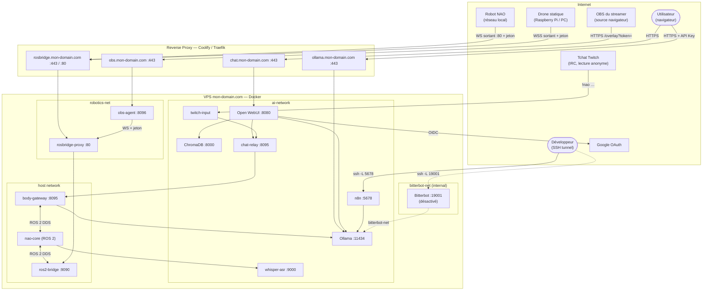

# ia-agent — Stack IA unifiée

Stack IA auto-hébergée sur VPS Ubuntu, déployée via Docker Compose et gérée par Coolify. Elle regroupe un moteur LLM, une interface de chat, un orchestrateur de workflows, une mémoire vectorielle, un agent autonome et une infrastructure robotique (NAO via ROS 2).

## Documentation

| Section | Description |
|---|---|
| [Architecture](docs/architecture.md) | Vision, infrastructure, réseaux Docker |
| [Récapitulatif des containers](docs/containers-overview.md) | Tableau synthétique de tous les containers, entrées/sorties, formats |
| [Stack IA](docs/ia-stack.md) | Ollama, Open WebUI, n8n, ChromaDB, Bitterbot |
| [Bridge IA / ROS 2 / NAO](docs/bridge-ia-ros2-nao.md) | nao-core, body-gateway, ros2-bridge, topics ROS 2 |
| [Robot NAO](docs/nao.md) | Bridge embarqué sur le robot, déploiement, autostart |
| [Test de la chaîne](docs/test-chain.md) | Diagnostic maillon par maillon WebUI → NAO |
| [Coolify & VPS](docs/coolify-vps.md) | Prérequis VPS, déploiement Coolify, CI/CD, cloud sync |

### Décisions d'architecture (ADR)

| ADR | Décision |
|---|---|
| [ADR 001](docs/decisions/001-ros2-over-ros1.md) | ROS 2 plutôt que ROS 1 |
| [ADR 002](docs/decisions/002-nao-websocket-bridge.md) | Bridge WebSocket embarqué sur NAO (sans VPN ni Raspberry Pi) |
| [ADR 003](docs/decisions/003-ollama-direct-sans-bitterbot.md) | Ollama direct sans Bitterbot pour body-gateway |
| [ADR 004](docs/decisions/004-drone-statique.md) | Drone statique Raspberry Pi pour les sens, NAO réduit au rendu émotif |
| [ADR 005](docs/decisions/005-avatar-twitch.md) | Une seule boucle stimulations → LLM → actions : Twitch comme entrée, OBS comme voix |
| [ADR 006](docs/decisions/006-nao-via-drone-statique.md) | Le NAO ne sort vers le VPS qu'à travers un relais sur le drone statique |

---

## Architecture



Toutes les entrées (« ok nao » dans la pièce, Open WebUI, tchat Twitch, capteurs)
passent par la même boucle : texte → `body-gateway` (LLM) → liste d'actions
répartie sur les corps (NAO, voix de la pièce, voix du stream). Voir
[ADR 005](docs/decisions/005-avatar-twitch.md).

---

## Structure du dépôt

```
ia-agent/
├── core/bitterbot/          → Dockerfile + config template de l'agent Bitterbot
├── robotics/
│   ├── brain/               → Cerveau générique, indépendant du type de drone
│   │   ├── body_gateway/    → Cerveau ROS 2 : LLM ↔ corps robotiques
│   │   ├── ros2_bridge/     → Dockerfile rosbridge_server WebSocket
│   │   └── webui/           → Pipe Open WebUI (nao_pipe.py)
│   ├── inputs/
│   │   └── twitch/          → Entrée tchat Twitch « !nao » → body-gateway (ADR 005)
│   ├── shared/              → Classes partagées (RobotBridgeBase)
│   └── drones/
│       ├── nao/
│       │   ├── onboard/     → nao_ws_bridge.py (script exécuté SUR le robot)
│       │   ├── bridge/      → HTTP bridge Flask vers NAO (container naoqi-bridge)
│       │   ├── driver/      → Nœud ROS 2 : topics → HTTP vers naoqi-bridge
│       │   ├── cognitive_renderer/ → Nœud ROS 2 : état cognitif → LEDs / tête
│       │   ├── motion_engine/ → Package ROS 2 : synthèse biomécanique (émotion → mouvement)
│       │   └── core/        → Dockerfile + entrypoint du container nao-core
│       ├── static/          → Drone statique (ADR 004) : onboard/ (Raspberry Pi / PC) + driver/ (nœud ROS 2 VPS)
│       ├── obs/             → Voix de NAO sur le stream : overlay OBS (ADR 005)
│       └── quadcopter/      → Réservé
├── docs/
│   ├── architecture.md
│   ├── containers-overview.md
│   ├── ia-stack.md
│   ├── bridge-ia-ros2-nao.md
│   ├── nao.md
│   ├── test-chain.md
│   ├── coolify-vps.md
│   └── decisions/           → ADR (Architecture Decision Records)
├── tests/                   → test-chain.sh, diagnostics NAO, faux drone statique
├── .github/workflows/
│   ├── build-bitterbot.yml  → Build + push $DOCKERHUB_USERNAME/bitterbot
│   └── build-robotics.yml   → Build + push des 6 images robotiques (naoqi-bridge, nao-core,
│                              body-gateway, ros2-bridge, twitch-input, obs-agent)
├── setup-vps.sh             → Préparation du VPS (dossiers, firewall, jetons)
└── docker-compose.yml
```

---

## Accès rapide aux services

| Service | URL / commande | Auth |
|---|---|---|
| Open WebUI | `https://chat.$DOMAIN` | Google SSO |
| API Ollama | `https://ollama.$DOMAIN` | `Authorization: Bearer $OLLAMA_API_KEYS` |
| n8n | `ssh -L 5678:localhost:5678 $VPS_USER@$DOMAIN` | Basic auth |
| Bitterbot | `ssh -L 19001:localhost:19001 $VPS_USER@$DOMAIN` | Token WS |
| rosbridge | `wss://rosbridge.$DOMAIN` (`ws://` port 80 pour le NAO) | `Authorization: Bearer $ROSBRIDGE_TOKEN` |
| Overlay OBS (voix du stream) | `https://obs.$DOMAIN/overlay?token=$OBS_TOKEN` (source navigateur OBS) | Jeton dans l'URL |
